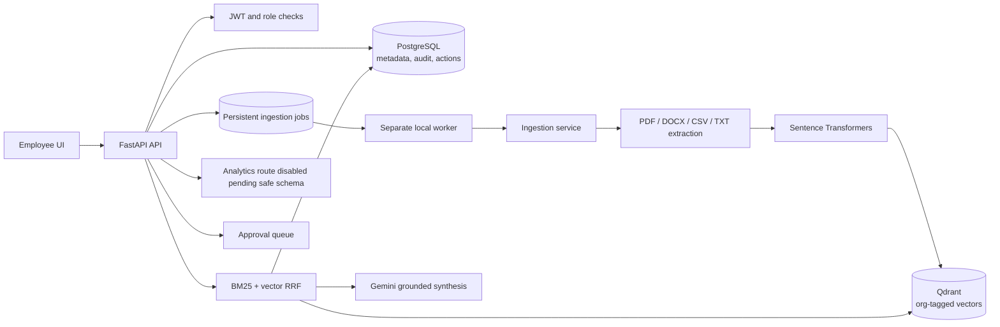

# Northstar: Enterprise Knowledge & Action

A portfolio starter for a tenant-aware internal knowledge assistant, now positioned for industrial maintenance investigations. Current code supports document processing, hybrid retrieval, Gemini synthesis, audit trails, approval requests, synthetic industrial records and a small set of fixed tenant-scoped analytics. It does not execute client-supplied SQL and is not represented as a completed production deployment.

## Run locally

Requirements: Python 3.11+, Docker Desktop, and (for generated answers) a Gemini API key.

```powershell
Copy-Item .env.example .env
# Set a unique JWT_SECRET and a strong BOOTSTRAP_PASSWORD in .env.
docker compose up --build
```

The API and UI are at `http://localhost:8000`; interactive API docs are at `/docs`. Compose runs a migration job, API, separate ingestion worker, PostgreSQL and Qdrant. The local development bootstrap administrator is configured by `BOOTSTRAP_EMAIL` and `BOOTSTRAP_PASSWORD`. Change the example values before any shared deployment. The default login values are only convenience values for a throwaway local instance.

For a Python-only run, create a virtual environment, install `pip install -e '.[dev]'`, set `DATABASE_URL=sqlite:///./enterprise_ai.db` and `QDRANT_URL=http://localhost:6333`, run `alembic upgrade head`, then start both `uvicorn app.main:app --reload` and `python -m app.worker` from this directory. On first use, Sentence Transformers downloads the configured embedding model. Ingestion requires Qdrant and that model to be reachable.

After migrations, seed a clean demo organization with `python -m app.seed_demo --as-of 2026-11-16 --seed 20261116`. The generator records its provenance and is idempotent per organization and dataset. It refuses to mix demo data into an organization that already contains equipment records.

## Included flows

- Login with signed access tokens, password hashing, roles, organization-scoped endpoints, same-organization admin user creation and document role/user allowlists.
- PDF, DOCX, CSV and TXT uploads; content hashing; immutable same-name versions; soft deletion; manual reindex; persisted ingestion jobs with progress, bounded retry/backoff and stale-worker recovery; metadata extraction and overlap chunking.
- Sentence Transformer vectors in Qdrant, BM25 lexical ranks and reciprocal-rank fusion, optional CrossEncoder reranking, and equipment-ID filtering. Qdrant filters by organization; candidates are intersected with current, non-deleted tenant chunks in SQL.
- Gemini synthesis constrained to retrieved snippets, visible source markers, abstention when there are no hits, and conversation history supplied as context only.
- Industrial relational schema for facilities, equipment, failures, maintenance, work orders, spare parts, inventory, operating metrics and safety incidents. `python -m app.seed_demo` generates deterministic, clearly synthetic records (including M-204 case data); generation refuses to mix into an organization that already has equipment data.
- `POST /api/data/query` routes supported natural-language requests to fixed parameterized analytics for tagged-equipment failure history, compatible spare-part stock, 90-day downtime by category, MTBF estimates and top failure-frequency rankings. Raw SQL remains rejected; unsupported requests do not execute a query.
- `POST /api/investigations` returns a deterministic plan with structured findings and ACL-filtered document evidence, preserving source form instead of synthesizing unchecked numeric claims.
- Action request review queue with approval, rejection and a repeat-safe simulated execution adapter. Approved work-order proposals can create internal work-order records; no external system is contacted.
- Web dashboard for uploads, document status, questions, evidence snippets, workflow steps, action requests and basic counts.
- Explicit Alembic migrations, Compose API/migration/worker/database/vector services, DB-aware health check, CI workflow and unit/tenant test sets.
- Optional OpenTelemetry FastAPI tracing over OTLP, request timing logs with route templates and request IDs, worker job duration/status events, and an admin-only tenant queue summary. Configure `OTEL_EXPORTER_OTLP_ENDPOINT` to export traces; without it, traces are not exported.

Run the deterministic analytics routing/evidence smoke evaluation against a seeded organization with `python -m app.evaluate_analytics --organization-id <ORG_ID>`. The current eight-case set is a small regression check, not the planned broad benchmark.

## API outline

| Route | Purpose |
| --- | --- |
| `POST /api/auth/token` | OAuth2 password grant for local accounts |
| `GET /api/me` | Current user and organization |
| `POST/GET /api/documents` | Upload and list tenant documents |
| `GET /api/documents?include_history=true` | Include superseded versions |
| `GET /api/documents/{id}/versions` | List a document family's versions |
| `PUT /api/documents/{id}/access` | Admin-set document role/user allowlists |
| `POST /api/documents/{id}/reindex` | Queue a reindex job for the current version |
| `DELETE /api/documents/{id}` | Admin soft-delete a document family and remove indexed content |
| `GET /api/ingestion-jobs/{id}` | Read tenant-scoped job status and progress |
| `POST /api/query` | Hybrid evidence retrieval and answer synthesis |
| `POST /api/investigations` | Structured analytics plus ACL-filtered document evidence |
| `POST /api/data/query` | Fixed tenant-scoped analytics; body `{ "question": "Show failure history for M-204" }`; raw `sql` is rejected |
| `POST/GET /api/actions` | Propose and list approval-gated actions |
| `POST /api/actions/{id}/approve|reject|execute` | Admin review and simulated idempotent adapter |
| `POST /api/admin/users` | Add a same-organization account |
| `GET /api/dashboard` | Tenant-scoped counts |
| `GET /api/admin/ingestion/summary` | Admin-only tenant queue status and failed-job counts |

## Architecture



## Important engineering limits

- The local polling worker uses PostgreSQL job state and retry scheduling; it is not a substitute for Cloud Tasks/Pub/Sub, a managed dead-letter queue or multi-region worker operations.
- Startup no longer creates tables automatically. Compose runs Alembic as a one-shot migration service; apply migrations as a controlled release step in other deployments.
- Qdrant and PostgreSQL hold separate copies of chunk content. Search intersects vector candidates with current, non-deleted SQL chunks, preventing obsolete versions from being returned. There is no periodic reconciliation for orphan vectors.
- Analytics and NL-to-SQL are not implemented. The previous regex SQL executor is removed; do not enable query execution until AST validation, tenant scoping and a dedicated read-only DB role are in place.
- There is no organization provisioning endpoint, SSO/OIDC, PostgreSQL RLS, rate limiting, WebSocket stream, agent graph, or external tool adapter in this first slice. Document ACLs are app-enforced; their API tests require the full auth dependencies.
- Citations identify source document and chunk section ordinal. PDF page-level and DOCX heading citations need richer extraction metadata.
- The UI stores the access token in memory, and refresh requires signing in again.

## Security and deployment notes

Use a managed secrets store, TLS, private networking, a dedicated read-only analytics role, Cloud SQL and private Qdrant deployment for a GCP installation. Store originals in a private Cloud Storage bucket with tenant-aware object paths and retention policies. Configure rate limits and request-size limits at the edge, rotate JWT secrets, add account lifecycle controls, and redact sensitive query text from audit logs as required by policy. The Compose Postgres password is for local use only. Never deploy the example `.env` values. See [SECURITY.md](SECURITY.md) for the current gaps.

No cloud cost or latency claim is included because no GCP resources or benchmark runs have been configured. Before making resume claims, evaluate a fixed corpus and question set; report Recall@K, MRR, citation precision, faithfulness review, p50/p95 latency and token cost with reproducible settings.

## Evaluation and CI

Run `pytest` and `ruff check app tests`. The current executed tests cover chunking, CSV metadata, upload content checks and production secret validation. Tenant API adversarial tests are included but skip when PyJWT/pwdlib are not installed; they have not yet been executed in this workspace. No test here is a retrieval-quality evaluation. See [EVALUATION.md](EVALUATION.md) for the benchmark plan and [IMPLEMENTATION_PLAN.md](IMPLEMENTATION_PLAN.md) for status.

## Engineering documents

- [Architecture](ARCHITECTURE.md)
- [Implementation plan and feature matrix](IMPLEMENTATION_PLAN.md)
- [Security review](SECURITY.md)
- [Evaluation methodology](EVALUATION.md)
- [Deployment status and guide](DEPLOYMENT.md)
- [API reference](API.md)
- [Architecture decision records](adr/)
