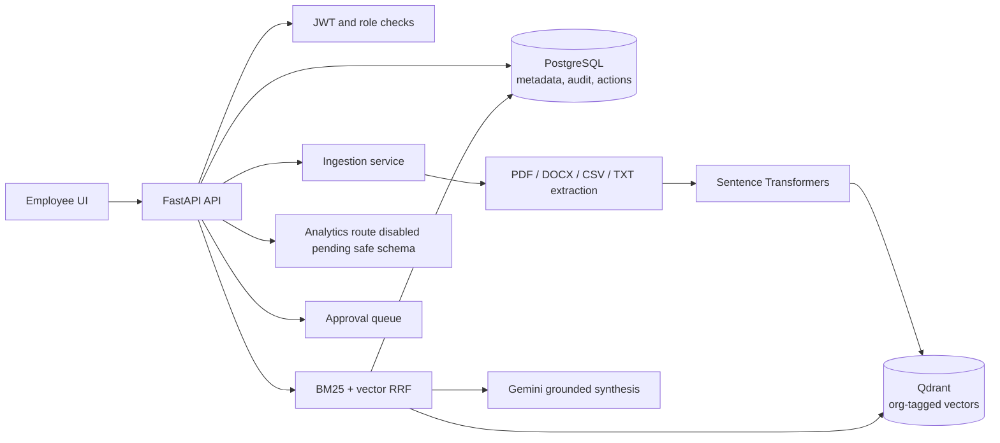

# Northstar: Enterprise Knowledge & Action

A portfolio starter for a tenant-aware internal knowledge assistant, now positioned for industrial maintenance investigations. Current code supports basic document processing, hybrid retrieval, Gemini synthesis, audit trails and approval requests. Client-supplied SQL execution is intentionally disabled pending a tenant-safe schema-aware implementation. It is not represented as a completed production deployment.

## Run locally

Requirements: Python 3.11+, Docker Desktop, and (for generated answers) a Gemini API key.

```powershell
Copy-Item .env.example .env
# Set a unique JWT_SECRET and a strong BOOTSTRAP_PASSWORD in .env.
docker compose up --build
```

The API and UI are at `http://localhost:8000`; interactive API docs are at `/docs`. Compose supplies PostgreSQL and Qdrant. The local development bootstrap administrator is configured by `BOOTSTRAP_EMAIL` and `BOOTSTRAP_PASSWORD`. Change the example values before any shared deployment. The default login values are only convenience values for a throwaway local instance.

For a Python-only run, create a virtual environment, install `pip install -e '.[dev]'`, set `DATABASE_URL=sqlite:///./enterprise_ai.db` and `QDRANT_URL=http://localhost:6333`, then run `uvicorn app.main:app --reload` from this directory. On first use, Sentence Transformers downloads the configured embedding model. Ingestion requires Qdrant and that model to be reachable.

## Included flows

- Login with signed access tokens, password hashing, roles, organization scoped endpoints and same-organization admin user creation.
- PDF, DOCX, CSV and TXT uploads; metadata extraction; deterministic overlap chunking; content deduplication; ingestion status and failure capture.
- Sentence Transformer vectors in Qdrant, BM25 lexical ranks and reciprocal-rank fusion. Qdrant filters by organization; lexical candidates and returned chunks are independently scoped through SQL.
- Gemini synthesis constrained to retrieved snippets, visible source markers, abstention when there are no hits, and conversation history supplied as context only.
- Structured data analytics are not available yet. `POST /api/data/query` returns 503; the prior regex-only SQL executor was removed because it lacked a real schema, tenant enforcement and database-level least privilege.
- Action request review queue with role-gated approval and audit events. Approval only changes request status; no external operation executes.
- Web dashboard for uploads, document status, questions, evidence snippets, workflow steps, action requests and basic counts.
- Explicit initial Alembic migration, Compose services, DB-aware health check, CI workflow and starter unit tests.

## API outline

| Route | Purpose |
| --- | --- |
| `POST /api/auth/token` | OAuth2 password grant for local accounts |
| `GET /api/me` | Current user and organization |
| `POST/GET /api/documents` | Upload and list tenant documents |
| `POST /api/query` | Hybrid evidence retrieval and answer synthesis |
| `POST /api/data/query` | Reserved; returns 503 until safe industrial analytics are implemented |
| `POST/GET /api/actions` | Request and list approval-gated actions |
| `POST /api/actions/{id}/approve` | Admin approval record |
| `POST /api/admin/users` | Add a same-organization account |
| `GET /api/dashboard` | Tenant-scoped counts |

## Architecture



## Important engineering limits

- FastAPI background tasks run ingestion in-process. They are suitable for a demo, not crash-safe delivery or large collections. Replace with a durable queue (e.g. Cloud Tasks or Pub/Sub plus Cloud Run worker), idempotent job records, bounded retries and dead-letter handling.
- Development startup creates tables for a zero-setup demo. Production startup skips `create_all`; apply Alembic migrations through a controlled deployment step.
- Qdrant and PostgreSQL hold separate copies of chunk content. A reconciler and deletion/version update lifecycle are required before treating updates as complete. Current duplicate content is deduplicated; replacing documents by filename/version is not implemented.
- Analytics and NL-to-SQL are not implemented. The previous regex SQL executor is removed; do not enable query execution until AST validation, tenant scoping and a dedicated read-only DB role are in place.
- There is no organization provisioning endpoint, SSO/OIDC, document ACL beyond organization membership, rate limiting, WebSocket stream, agent graph, or external tool adapter in this first slice.
- Citations identify source document and chunk section ordinal. PDF page-level and DOCX heading citations need richer extraction metadata.
- The UI stores the access token in memory, and refresh requires signing in again.

## Security and deployment notes

Use a managed secrets store, TLS, private networking, a dedicated read-only analytics role, Cloud SQL and private Qdrant deployment for a GCP installation. Store originals in a private Cloud Storage bucket with tenant-aware object paths and retention policies. Configure rate limits and request-size limits at the edge, rotate JWT secrets, add account lifecycle controls, and redact sensitive query text from audit logs as required by policy. The Compose Postgres password is for local use only. Never deploy the example `.env` values. See [SECURITY.md](SECURITY.md) for the current gaps.

No cloud cost or latency claim is included because no GCP resources or benchmark runs have been configured. Before making resume claims, evaluate a fixed corpus and question set; report Recall@K, MRR, citation precision, faithfulness review, p50/p95 latency and token cost with reproducible settings.

## Evaluation and CI

Run `pytest` and `ruff check app tests`. The current executed tests cover chunking, CSV metadata, upload content checks and production secret validation. Tenant API adversarial tests are included but skip when PyJWT/pwdlib are not installed; they have not yet been executed in this workspace. No test here is a retrieval-quality evaluation. See [EVALUATION.md](EVALUATION.md) for the benchmark plan and [IMPLEMENTATION_PLAN.md](IMPLEMENTATION_PLAN.md) for status.

## Engineering documents

- [Architecture](ARCHITECTURE.md)
- [Implementation plan and feature matrix](IMPLEMENTATION_PLAN.md)
- [Security review](SECURITY.md)
- [Evaluation methodology](EVALUATION.md)
- [Deployment status and guide](DEPLOYMENT.md)
- [API reference](API.md)
- [Architecture decision records](adr/)
